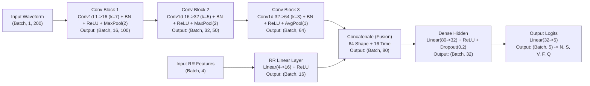

# Complete Project Walkthrough & Plain-English Guide (`EXPLAIN.md`)

This document explains the entire **ECG Beat Classification** project from start to finish in **simple, clear English** — covering domain knowledge, data files, preprocessing, formulas, model architectures, layer-by-layer shape changes, confusion matrices, and failure modes.

---

## 1. Problem Statement & Domain Knowledge (Start Here)

### What is the Problem Statement?
Given a continuous **Electrocardiogram (ECG)** recording of a patient's heart, our goal is to automatically locate every individual heartbeat, extract its waveform and timing context, and classify it into **1 of 5 standard medical beat types (AAMI EC57)**:
- **Is this beat Normal (`N`)**, or is it an **irregular/dangerous beat (`S`, `V`, `F`, `Q`)**?
- **Engineering Goals**: Zero patient data leakage (must generalize to completely unseen patients), handle severe class imbalance, and keep the model **lightweight and CPU-friendly** for real-time cardiac monitoring.

### What is an ECG and a Heartbeat (PQRST Waves)?
Every time your heart beats, it creates tiny electrical signals. An **ECG** records these electrical voltages over time as a continuous 1D wave. Each single heartbeat has three main parts called the **PQRST waves**:

```text
          R (Sharp Peak / Center)
          |
          /\
         /  \
   P    /    \      T
  / \  /      \    / \
_/___\/________\__/___\_
     Q          S
 <-- 90 samples -->|<-- 110 samples -->
    (250 ms)       |     (305 ms)
 <---------- 200 Samples (556 ms) ---------->
```

1. **P-wave**: Upper chambers (atria) contract to push blood down.
2. **QRS Complex (R-peak)**: Lower chambers (ventricles) contract strongly to pump blood to the body. The sharp upward spike is the **R-peak**.
3. **T-wave**: Ventricles relax and recharge electrically for the next beat.

When a heartbeat happens at the wrong time or originates from the wrong part of the heart muscle, its **wave shape** or **timing** changes. This irregular beat is called an **Arrhythmia**.

### The 5 Medical Classes (AAMI EC57 Standard)
Cardiologists originally annotated MIT-BIH with 15+ symbols. Following the **AAMI EC57** standard, we map all valid beat symbols into **5 clinical classes**:

| Class | Full Name | Plain-English Meaning | Original MIT-BIH Symbols |
| :---: | :--- | :--- | :--- |
| **N** | Normal / Non-ectopic | Healthy normal beats (and bundle branch block / escape beats) | `N`, `L`, `R`, `e`, `j` |
| **S** | Supraventricular Ectopic | Early beat starting in the upper chambers (atria / AV node) | `A`, `a`, `J`, `S` |
| **V** | Ventricular Ectopic | Dangerous early beat starting in the lower chambers (ventricles) | `V`, `E` |
| **F** | Fusion Beat | Hybrid beat where a Normal beat and a Ventricular beat collide at the same time | `F` |
| **Q** | Unknown / Paced | Stray paced or unclassifiable beats | `/`, `f`, `Q` |

*Note: Non-beat markers like `+` (rhythm change), `~` (signal noise), `!` (flutter marker), and `"` (comment) are NOT heartbeats, so we ignore them.*

---

## 2. Dataset Overview, Key Settings & File Structure

### Where Did the Data Come From?
- **Database**: **MIT-BIH Arrhythmia Database** from PhysioNet.
- **Python Package Used**: **`wfdb`** (Waveform Database — the official Python library for downloading and reading PhysioNet ECG signals and annotations).
- **Size & Recording Details**:
  - **47 subjects (patients)** producing **48 recordings** (one patient was recorded twice).
  - Each recording is **~30 minutes** long.
  - **2 channels (leads)** recorded simultaneously using a portable Holter monitor **while the patient walked and did normal daily activities** (ambulatory ECG).
  - **Sampling Rate**: **360 Hz** (360 data points recorded every second).

### Key Extraction Parameters (Upfront Summary)
- **Sampling Rate**: `360 Hz`
- **Samples Before R-peak**: `90 samples` ($90 / 360 = 250\text{ ms}$, captures P-wave & PR interval)
- **Samples After R-peak**: `110 samples` ($110 / 360 = 305\text{ ms}$, captures ST segment & T-wave)
- **Total Window Size**: `200 samples` ($90 + 110 = 200$ points $\approx 556\text{ ms}$ per beat)
- **Selected Lead**: **MLII (Modified Lead II)** — gives the clearest, sharpest QRS view.
  - *Important Engineering Detail*: In 43 of 44 records, MLII is Channel `0`. In **Record `114`**, the channels are swapped (`['V5', 'MLII']`). Our code searches `record.sig_name` by name so it always picks `'MLII'` accurately!

### What Files Exist for Each Patient? (4 File Types)
On PhysioNet, each patient record (for example, Record `100`) has 4 file types:

| File | Full Name | What It Contains & How We Use It |
| :--- | :--- | :--- |
| **`100.hea`** | Header File | Small plain-text metadata file (5 lines): tells us `360 Hz`, `650,000` samples, channel names (`MLII`, `V5`), patient age/gender, and medications. |
| **`100.dat`** | Data File | **Binary file** (~1.95 MB) storing the raw voltage numbers in compact **11-bit `212` binary format**. When `wfdb.rdrecord()` reads `.dat` + `.hea`, it decodes those binary bytes into a clean **1D NumPy floating-point array** (in millivolts, `mV`). |
| **`100.atr`** | Annotation File | Binary file containing the cardiologists' ground-truth labels: exact R-peak sample positions (`ann.sample`) and beat symbols (`ann.symbol`). Read using `wfdb.rdann()`. |
| **`100.xws`** | WAVE Script File | Optional display configuration file on the PhysioNet website for their legacy WAVE viewer. Not needed for ML, so `wfdb` does not download it locally. |

### What Records Were Removed & Why?
- Out of **48 total records**, **4 paced records (`102`, `104`, `107`, `217`)** were removed.
- **Why?** Those 4 patients had artificial electronic pacemakers, which produce unnatural sharp pacemaker spikes instead of natural heart waves. Standard AAMI rules require excluding them.
- Remaining clean dataset = **44 records** (`100,705` total valid beats).
- Also, **67 boundary beats** across all 44 records occurred within 90 samples of the very start or 110 samples of the very end of the recording; we skipped them since a full 200-sample window cannot be sliced there.

---

## 3. Data Preprocessing, Beat Slicing & Normalization

### Step 1: Signal Conversion & Beat Slicing
1. `wfdb.rdrecord()` converts the binary `.dat` file into a continuous 1D NumPy array of length `650,000` (~30 minutes).
2. We loop through every valid beat R-peak index $r$ from `.atr`.
3. We cut a **200-sample slice**: `signal[r - 90 : r + 110]`.
   - Every beat is now a 1D NumPy array of **200 voltage values**.

### Step 2: Per-Beat Z-Score Normalization
Why can't we feed raw voltages directly into the model?
- Every human body is different (different chest thickness, skin resistance, electrode placement).
- Breathing and walking cause the ECG line to slowly drift up and down (**baseline wander**).
- One person's R-peak might be `2.5 mV`, while another person's healthy R-peak is `0.8 mV`.

To make every beat comparable across all patients, we apply **Z-score normalization** to **each individual 200-sample beat**:

$$\hat{x} = \frac{x - \text{mean}(x)}{\text{std}(x) + 10^{-8}}$$

**What Every Term Means:**
- **$x$**: The raw cut beat (200 voltage points).
- **$\text{mean}(x)$**: The average voltage of those 200 points (represents the local baseline level).
- **$x - \text{mean}(x)$**: Shifts the beat so its average sits at `0` — this removes breathing drift / baseline offset.
- **$\text{std}(x)$**: Standard deviation (how tall/spread-out the beat waves are). Dividing by `std(x)` scales every beat to unit height (`std = 1`), forcing the model to focus purely on **wave shape**, not raw voltage amplitude.
- **$+ 10^{-8}$ (`0.00000001`)**: A tiny safety constant. If a wire momentarily disconnects and outputs a flat line (`[0, 0, 0, ...]`), `std(x)` becomes `0`. Adding `10^{-8}` prevents division-by-zero (`NaN`) crashes.
- **$\hat{x}$ ("x-hat")**: The final clean, zero-mean, unit-variance 200-sample beat fed into our models.

---

## 4. Train / Validation / Test Splitting (Zero Data Leakage)

### Why NOT a Random Beat-Level Split?
If we put all `100,705` beats into one bucket, shuffled them randomly, and split 80% Train / 20% Test:
- Beats from the **same patient** would appear in both Train and Test.
- The model would memorize each patient's personal ECG shape instead of learning general heart diseases (**patient data leakage**).
- It would falsely report ~99% accuracy, then fail completely on a brand-new patient in a hospital!

### Our Solution: de Chazal Inter-Patient Split
We split strictly **by patient** using the standard **de Chazal et al. (2004)** benchmark split:

```text
48 MIT-BIH Records
   │
   ├── Remove 4 Paced Records (102, 104, 107, 217)
   │
   ▼
44 Clean Records (100,705 beats)
   │
   ├──► DS1 (22 Patients) ──► Train (18 Patients = 42,160 beats)
   │                      └──► Val   (4 Patients: 115, 118, 201, 205 = 8,848 beats)
   │
   └──► DS2 (22 Unseen Patients) ──► Final Test Set (49,697 beats) [NEVER TOUCHED DURING TRAINING]
```

**Exact Beat Counts Across Splits:**

| Split | Records | Total Beats | N | S | V | F | Q |
| :--- | :---: | :---: | :---: | :---: | :---: | :---: | :---: |
| **Train (DS1)** | 18 | **42,160** | 37,531 | 717 | 3,503 | 401 | 8 |
| **Val (DS1 Held-Out)** | 4 | **8,848** | 8,323 | 227 | 285 | 13 | 0 |
| **Test (DS2 Unseen)** | 22 | **49,697** | 44,245 | 1,837 | 3,220 | 388 | 7 |

*Note: All feature scalers (`StandardScaler`) were fitted **strictly on DS1 Train** only, then applied to Val and Test.*

---

## 5. Feature Engineering (Shape + Rhythm Time Features)

A cardiologist never looks only at a beat's **shape** (PQRST wave) — they also check **timing** (*Did this beat arrive too early? Was there a pause after it?*).

So besides the 200-sample waveform, we calculate **4 RR-interval timing features** (in seconds, using consecutive valid beat positions $r_i$ at 360 Hz):

1. **$RR_{\text{prev}}$ (Previous RR Interval)**:
   $$RR_{\text{prev}} = \frac{r_i - r_{i-1}}{360.0}$$
   Time gap before the current beat. A very small value means the beat arrived **prematurely** (early).
2. **$RR_{\text{next}}$ (Next RR Interval)**:
   $$RR_{\text{next}} = \frac{r_{i+1} - r_i}{360.0}$$
   Time gap after the current beat. Premature Ventricular Contractions (`V`) usually trigger a long **compensatory pause** right after.
3. **$RR_{\text{avg10}}$ (Average of Last 10 RRs)**:
   $$RR_{\text{avg10}} = \frac{1}{m} \sum_{j=\max(0, i-10)}^{i-1} RR_j$$
   Represents the patient's recent local heart rate baseline.
4. **$RR_{\text{ratio}}$ (Prematurity Ratio)**:
   $$RR_{\text{ratio}} = \frac{RR_{\text{prev}}}{RR_{\text{avg10}} + 10^{-8}}$$
   Compares the current gap to the patient's recent average. For example, `0.60` means the beat fired 40% earlier than normal!

*(Boundary handling: For the very first beat of a record, $RR_{\text{prev}} = RR_{\text{next}}$ and $RR_{\text{avg10}} = RR_{\text{prev}}$; for the very last beat, $RR_{\text{next}} = RR_{\text{prev}}$.)*

---

## 6. Handling Severe Class Imbalance & Loss Function

### Why Is Class Imbalance Dangerous Here?
In our 42,160 training beats:
- **N**: `37,531` (**89.02%**)
- **V**: `3,503` (**8.31%**)
- **S**: `717` (**1.70%**)
- **F**: `401` (**0.95%**)
- **Q**: `8` (**0.02%**)

A lazy "dummy" model that predicts **`N` for every single beat** automatically gets **89% accuracy** — while missing 100% of dangerous heart arrhythmias!

### Our Solution: Class-Weighted Cross-Entropy Loss
We keep the test set completely realistic (never oversample or alter DS2). During training only, we assign higher loss penalties to rare classes using **Square-Root Smoothed Inverse Class Frequency**:

$$w_c = \sqrt{\frac{N_{\text{total}}}{K \cdot N_c}}, \qquad \bar{w}_c = \frac{w_c}{\frac{1}{K}\sum_{k=1}^{K} w_k}$$

Where $N_{\text{total}} = 42,160$, $K = 5$ classes, and $N_c$ is the training beat count for class $c$.

### Why Use Square Root Instead of Standard Inverse Frequency?
Look at what happens **without** square root vs **with** square root for our rarest class `Q` (only 8 beats) vs `N` (37,531 beats):

| Metric | Standard Inverse ($\frac{N_{\text{total}}}{K \cdot N_c}$) | With Square Root ($\sqrt{\frac{N_{\text{total}}}{K \cdot N_c}}$) |
| :--- | :--- | :--- |
| **Q Weight vs N Weight** | `1,054` vs `0.225` (**~4,680x gap!**) | `32.47` vs `0.474` (**~68x gap**) |
| **Training Effect** | One misclassified `Q` beat creates a massive gradient spike, making gradient descent unstable / explode! | Strong penalty for rare classes, smooth and stable training! |

**Exact Final Normalized Weights Applied in `CrossEntropyLoss`:**
- **$w_N = 0.056$** $\to$ Lowest penalty (common normal beats)
- **$w_V = 0.183$** $\to$ ~3.3x higher than `N`
- **$w_S = 0.403$** $\to$ ~7.2x higher than `N`
- **$w_F = 0.539$** $\to$ ~9.6x higher than `N`
- **$w_Q = 3.819$** $\to$ **Highest penalty (~68x higher than `N`)**

---

## 7. Models & Architectures (1D CNN vs. Random Forest)

We built and compared **two models**: a lightweight **1D CNN** (deep learning) and a **Random Forest** (classical ML baseline).

---

### Model 1: Lightweight 1D CNN with RR Feature Fusion (`ECGBeatCNN`)

#### How Does a 1D Filter Work on the 200-Sample Array?
A 1D filter is just a tiny pattern-matching template that slides left-to-right across the 200 numbers (multiply and add):
```text
Beat slice: [0.1, 0.1, 1.5, 0.1, 0.1]  (1.5 is the sharp R-peak)
Filter:     [-1,  +2,  -1]             (Sharp-spike detector)

Position 1: (-1×0.1) + (2×0.1) + (-1×1.5) = -1.4  (No spike)
Position 2: (-1×0.1) + (2×1.5) + (-1×0.1) = +2.8  (BIG SCORE -> R-peak detected!)
Position 3: (-1×1.5) + (2×0.1) + (-1×0.1) = -1.4  (No spike)
```
Each filter turns the raw voltage array into a **pattern-score array**. Using multiple filters lets the network simultaneously detect P-waves, sharp R-peaks, wide QRS complexes, and inverted T-waves!

#### Visual Architecture & Exact Tensor Shape Flow



#### Level-by-Level Layer & Dimension Breakdown

1. **Level 1 — Conv Block 1**: `(B, 1, 200)` $\to$ `(B, 16, 200)` $\to$ **`(B, 16, 100)`**
   - `Conv1d(1 -> 16, kernel=7, padding=3)`: Expands 1 wave into **16 pattern channels** (edges, slopes, peaks).
   - `BatchNorm1d(16)`: Normalizes channel values for fast, stable training.
   - `ReLU()`: Sets negative noise to `0`, keeping positive pattern activations.
   - `MaxPool1d(2)`: Keeps the strongest peak in every 2-sample pair, cutting time length in half (`200 -> 100`).
2. **Level 2 — Conv Block 2**: `(B, 16, 100)` $\to$ `(B, 32, 100)` $\to$ **`(B, 32, 50)`**
   - `Conv1d(16 -> 32, kernel=5, padding=2)` + `BatchNorm` + `ReLU`: Combines simple edges into **32 wave parts** (P-wave, QRS width, T-wave).
   - `MaxPool1d(2)`: Halves length again (`100 -> 50`).
3. **Level 3 — Conv Block 3 (Compression to Shape Vector)**: `(B, 32, 50)` $\to$ `(B, 64, 50)` $\to$ **`(B, 64)`**
   - `Conv1d(32 -> 64, kernel=3, padding=1)` + `BatchNorm` + `ReLU`: Learns **64 high-level beat shape patterns**.
   - `AdaptiveAvgPool1d(1)` + `Flatten()`: Averages each of the 64 channels across all 50 time steps, compressing `(64, 50)` down into a single **`64`-number Shape Vector**.
4. **Parallel Branch — RR Rhythm Vector**: `(B, 4)` $\to$ **`(B, 16)`**
   - `Linear(4 -> 16)` + `ReLU()`: Projects the 4 RR timing features into a **`16`-number Timing Vector**.
5. **Fusion & Classification Head (Expanding 64+16, then Shrinking to 5 Classes)**:
   - **Concatenate**: Joins Shape (`64`) + Timing (`16`) = **`80` total features** (`(B, 80)`).
   - **Hidden Dense Layer**: `Linear(80 -> 32)` + `ReLU()` mixes shape and rhythm clues together (`(B, 32)`).
   - **Dropout (`0.2`)**: Randomly turns off 20% of neurons during training so the network cannot memorize individual training patients.
   - **Final Output Layer**: `Linear(32 -> 5)` outputs **5 raw class scores** (`N, S, V, F, Q`). Picking the highest score (`argmax`) gives the predicted beat class!
- **Total Size**: Only **11,989 parameters** (**169 KB** file) — trains in ~10.5 seconds/epoch on a standard CPU.

#### Training Epochs & Why Best Model Was Saved at Epoch 4
- We ran training for **12 epochs** (`lr = 0.001`, Adam optimizer, batch size `128`).
- At **Epoch 4**, **Validation Macro F1 peaked at `0.5413`** (Val Accuracy = `94.81%`).
- From **Epoch 5 to Epoch 12**, Train Accuracy kept rising (`98.16% -> 98.80%`), while Validation Macro F1 dropped (`0.4666 -> 0.3790`). That clearly showed the model was starting to **overfit** to the 18 training patients!
- Because `train.py` only checkpoints when `val_f1 > best_val_f1`, the final saved model [`models/best_ecg_cnn.pt`](file:///Users/deepakgannamaneni/Desktop/intern_work/models/best_ecg_cnn.pt) contains the **Epoch 4 weights**.

---

### Model 2: Random Forest Baseline (Classical ML Comparison)

Why build a Random Forest? To prove whether deep learning (1D CNN) actually beats simple handcrafted features!
- **Input (`32 handcrafted features` per beat)**:
  - `4` RR timing features (`rr_prev, rr_next, rr_avg_10, rr_ratio`)
  - `8` statistical summary features (`peak-to-peak, min, max, total energy, QRS energy [80:120], skewness, kurtosis, zero-crossings`)
  - `20` downsampled waveform points (every 10th sample of the 200-point beat: `beat[::10]`)
- **How It Works**: Trains **100 independent Decision Trees** (`max_depth=12`, `class_weight='balanced'`). Each tree learns yes/no threshold rules (e.g., *"Is `rr_ratio < 0.7` and `qrs_energy > 25`?"*) and votes for a class. The majority vote wins!
- **Saved File**: [`models/rf_baseline.joblib`](file:///Users/deepakgannamaneni/Desktop/intern_work/models/rf_baseline.joblib) (**7.4 MB**).

---

## 8. DS2 Evaluation Results, Confusion Matrices & Failure Modes

Both models were evaluated on the **49,697 beats** of the completely unseen **DS2 Test Set (22 new patients)**.

### Overall Comparison Table

| Metric | 1D CNN (Proposed) | Random Forest (Baseline) | Winner |
| :--- | :---: | :---: | :---: |
| **Overall Accuracy** | **92.49%** | 88.59% | **1D CNN (+3.90%)** |
| **Weighted Average F1** | **92.10%** | 90.00% | **1D CNN (+2.10%)** |
| **Macro Average F1** | **40.96%** | 40.93% | **1D CNN** |
| **Model Disk Size** | **169 KB** (11,989 params) | 7.4 MB (100 trees) | **1D CNN (42x smaller)** |

### Per-Class Precision, Recall & F1 on DS2

| Class | Test Support | 1D CNN (Precision / Recall / F1) | Random Forest (Precision / Recall / F1) |
| :---: | :---: | :---: | :---: |
| **N (Normal)** | 44,245 | **95.6%** / **96.5%** / **96.0%** | 95.6% / 91.9% / 93.7% |
| **S (Supraventricular)** | 1,837 | **21.1%** / **13.2%** / **16.2%** | 18.6% / 12.3% / 14.8% |
| **V (Ventricular)** | 3,220 | **90.8%** / 94.3% / **92.5%** | 88.8% / **96.0%** / 92.3% |
| **F (Fusion)** | 388 | 0.0% / 0.0% / 0.0% | **2.2%** / **14.2%** / **3.8%** |
| **Q (Unknown)** | 7 | 0.0% / 0.0% / 0.0% | 0.0% / 0.0% / 0.0% |

### Confusion Matrices Explained

#### 1D CNN Confusion Matrix (`reports/confusion_matrix_cnn.png`)
```text
               Pred N    Pred S    Pred V    Pred F   Pred Q
True N (44245) 42,688       876       166       514        1
True S  (1837)  1,483       242        72        40        0
True V  (3220)    154        28     3,037         1        0
True F   (388)    323         0        65         0        0
True Q     (7)      2         0         5         0        0
```

#### Random Forest Confusion Matrix (`reports/confusion_matrix_rf.png`)
```text
               Pred N    Pred S    Pred V    Pred F   Pred Q
True N (44245) 40,654       966       239     2,380        6
True S  (1837)  1,458       226       108        45        0
True V  (3220)     95        22     3,092        11        0
True F   (388)    294         1        38        55        0
True Q     (7)      3         0         4         0        0
```

### Why 1D CNN Is Better Than Random Forest
1. **Higher Precision & Much Fewer False Alarms**: Random Forest misclassified **2,380 Normal beats as Fusion (`F`)** (`2.2%` precision for `F`), flooding doctors with false alarms. The 1D CNN produced **4.6x fewer false `F` alarms** (`514` vs `2,380`), boosting Normal Recall from `91.9%` to **`96.5%`** and Overall Accuracy from `88.59%` to **`92.49%`**.
2. **Automatic Feature Learning**: Random Forest only sees 20 downsampled points and manual stats, losing fine waveform details. The 1D CNN slides filters over all 200 raw samples and learns optimal morphological patterns automatically.
3. **Edge/Wearable Ready**: At **169 KB**, the CNN is **42x smaller** than the 7.4 MB Random Forest.

### Clinical Failure Mode Analysis (Why `S` and `F` Struggle Across New Patients)
1. **S vs. N Confusion (`80.7%` of `S` beats predicted as `N`)**:
   - *Medical Reason*: Supraventricular beats (`S`) start in the upper chambers, then travel down the **normal ventricular wiring (His-Purkinje system)**. Therefore, on Lead MLII, their **QRS shape looks almost identical to a Normal beat**.
   - *Timing Overlap*: The main clues are tiny P-waves (often hidden in noise) and early timing. Because resting heart rates differ widely across unseen DS2 patients (60–100 bpm), an early beat in a slow-heart-rate patient looks similar in timing to a normal beat in a fast-heart-rate patient.
2. **F vs. V and F vs. N Confusion (`323` predicted `N`, `65` predicted `V`)**:
   - *Medical Reason*: A Fusion beat (`F`) is literally a **hybrid collision** of a Normal beat and a Ventricular beat. Depending on which impulse arrives first, it either looks 80% Normal or 80% Ventricular.
   - *Data Scarcity*: Out of `401` training `F` beats, `373` came from a single patient (`208`), so the model could not generalize `F` across unseen DS2 patients.
3. **Why Ventricular (`V`) Detection Succeeds (`94.3%` Recall, `92.5%` F1)**:
   - Ventricular beats travel slowly through thick ventricular muscle, creating a **distinctive wide, tall QRS complex**, plus a clear **compensatory pause** ($RR_{\text{next}}$ is long). Both the CNN shape filters and RR features capture this reliably across new patients!

---

## 9. Quick Code File Map (Where Everything Lives)

- [`prepare_dataset.py`](file:///Users/deepakgannamaneni/Desktop/intern_work/prepare_dataset.py): Downloads MIT-BIH via `wfdb`, selects MLII, excludes paced records, slices 200-sample beats, Z-score normalizes, computes 4 RR + 32 simple features, fits `StandardScaler` on DS1 Train, saves `.npz` splits.
- [`train.py`](file:///Users/deepakgannamaneni/Desktop/intern_work/train.py): Sets `seed=42`, defines `ECGBeatCNN`, computes square-root class weights, trains 12 epochs (saves best Epoch 4 checkpoint to [`models/best_ecg_cnn.pt`](file:///Users/deepakgannamaneni/Desktop/intern_work/models/best_ecg_cnn.pt)), trains Random Forest baseline ([`models/rf_baseline.joblib`](file:///Users/deepakgannamaneni/Desktop/intern_work/models/rf_baseline.joblib)).
- [`evaluate.py`](file:///Users/deepakgannamaneni/Desktop/intern_work/evaluate.py): Tests both models on untouched DS2, prints comparison table, saves confusion matrix PNGs and JSON metrics in `reports/`.
- [`requirements.txt`](file:///Users/deepakgannamaneni/Desktop/intern_work/requirements.txt): Pinned library versions (`wfdb==4.3.1`, `torch==2.15.0`, `scikit-learn==1.9.1`, etc.).
- [`REPORT.md`](file:///Users/deepakgannamaneni/Desktop/intern_work/REPORT.md): Formal clinical evaluation report.
