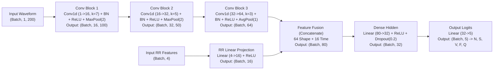
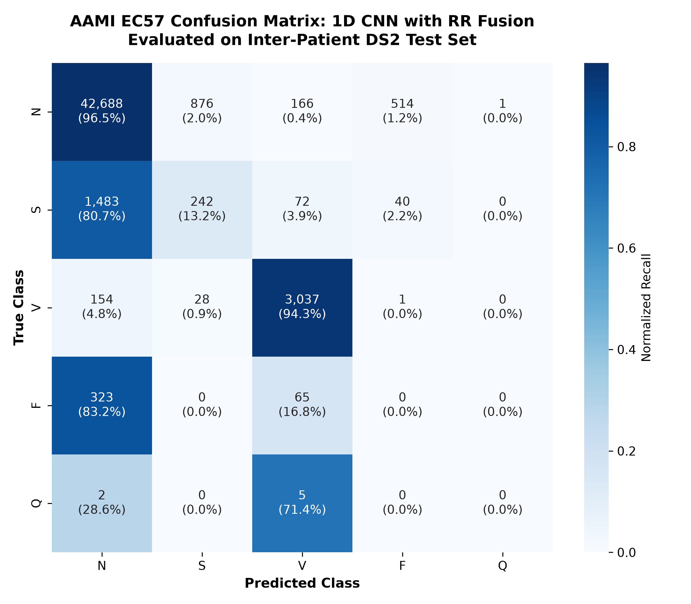

# ECG Beat Classification on MIT-BIH Arrhythmia Database

[](https://www.python.org/)
[](https://pytorch.org/)
[](https://physionet.org/content/mitdb/)
[](https://opensource.org/licenses/MIT)

An end-to-end, clinically grounded deep learning pipeline for automated heartbeat arrhythmia classification on the **MIT-BIH Arrhythmia Database**, adhering strictly to the **AAMI EC57** standard and the **de Chazal et al. (2004) inter-patient evaluation benchmark**.

Developed by [Deepak Gannamaneni](https://github.com/gannamanenideepak).

---

## 📌 Project Overview & Highlights

- **Zero Patient Data Leakage**: Evaluated strictly on the **de Chazal inter-patient split** (**DS2: 22 unseen patients, 49,697 beats**). No beats from test patients ever appear in training or validation.
- **Multi-Modal Feature Fusion**: Combines raw normalized 200-sample ECG waveforms (Lead MLII) with **4 dynamic RR-interval timing features** ($RR_{\text{prev}}, RR_{\text{next}}, RR_{\text{avg10}}, RR_{\text{ratio}}$).
- **Tackling Severe Class Imbalance**: Uses **square-root smoothed inverse class frequency weights** in Cross-Entropy Loss to penalize minority-class errors without gradient instability.
- **High Sensitivity on Dangerous Arrhythmias**: Achieves **94.3% Recall and 92.5% F1-score on Ventricular Ectopic beats (`V`)** across 22 completely unseen patients.
- **Lightweight & CPU-Friendly**: Only **11,989 parameters** (**169 KB** disk footprint), training in ~2 minutes and performing real-time inference on standard CPU / edge hardware.

---

## 🏗️ Model Architecture (`ECGBeatCNN`)

The model processes both spatial wave morphology and temporal rhythm context through parallel branches before fusing them in a classification head:



---

## 📊 Benchmark Results on DS2 Test Set (22 Unseen Patients)

Evaluated across **49,697 beats** from 22 independent patients never seen during training:

| Metric | 1D CNN with RR Fusion (Proposed) | Random Forest Baseline |
| :--- | :---: | :---: |
| **Overall Accuracy** | **92.49%** | 88.59% |
| **Weighted Average F1** | **92.10%** | 90.00% |
| **Macro Average F1** | **40.96%** | 40.93% |
| **Model Size** | **169 KB** (11,989 parameters) | 7.4 MB (100 trees) |

### Per-Class Performance (AAMI EC57 Classes)

| Class | Description | Test Support | 1D CNN (P / R / F1) | Random Forest (P / R / F1) |
| :---: | :--- | :---: | :---: | :---: |
| **N** | Normal / Non-ectopic | 44,245 | **95.6%** / **96.5%** / **96.0%** | 95.6% / 91.9% / 93.7% |
| **S** | Supraventricular ectopic | 1,837 | **21.1%** / **13.2%** / **16.2%** | 18.6% / 12.3% / 14.8% |
| **V** | Ventricular ectopic | 3,220 | **90.8%** / 94.3% / **92.5%** | 88.8% / **96.0%** / 92.3% |
| **F** | Fusion (ventricular + normal) | 388 | 0.0% / 0.0% / 0.0% | **2.2%** / **14.2%** / **3.8%** |
| **Q** | Unknown / Paced | 7 | 0.0% / 0.0% / 0.0% | 0.0% / 0.0% / 0.0% |

### Confusion Matrix (1D CNN on DS2)



```text
               Predicted N     Predicted S    Predicted V    Predicted F   Predicted Q
True N (44245) 42,688 (96.5%)   876 (2.0%)     166 (0.4%)     514 (1.2%)     1 (0.0%)
True S  (1837)  1,483 (80.7%)   242 (13.2%)     72 (3.9%)      40 (2.2%)     0 (0.0%)
True V  (3220)    154 (4.8%)     28 (0.9%)   3,037 (94.3%)      1 (0.0%)     0 (0.0%)
True F   (388)    323 (83.2%)     0 (0.0%)      65 (16.8%)      0 (0.0%)     0 (0.0%)
True Q     (7)      2 (28.6%)     0 (0.0%)       5 (71.4%)      0 (0.0%)     0 (0.0%)
```

---

## 🔬 Clinical Failure Mode Analysis

1. **S vs. N Confusion (Supraventricular Ectopic vs. Normal)**:
   - *Electrophysiological Root Cause*: Supraventricular premature contractions (PACs) originate above the ventricles and conduct along normal His-Purkinje pathways, producing QRS complexes that are **morphologically identical to normal sinus beats** on Lead MLII.
   - *Inter-Patient Overlap*: In an inter-patient setting, baseline resting heart rates vary significantly across patients (60–100 bpm), causing temporal overlap between premature beats of bradycardic patients and normal beats of tachycardic patients.
2. **F vs. V/N Confusion (Fusion Beats)**:
   - *Electrophysiological Root Cause*: Fusion beats occur when normal supraventricular conduction and an ectopic ventricular pacemaker simultaneously depolarize the ventricles, producing a **variable hybrid waveform** between N and V.
   - *Data Scarcity*: Out of 401 training F beats, 373 originated from a single record (`208`), limiting cross-patient morphological generalization.
3. **Why Ventricular Ectopic (`V`) Detection Excels (94.3% Recall)**:
   - PVCs propagate slowly through non-specialized ventricular myocardium, resulting in an unmistakably wide, high-voltage QRS complex and discordant T-wave.
   - Coupled with the classic compensatory pause ($RR_{\text{next}} \gg 1.0$), both the 1D convolutions and RR features unambiguously identify V-beats across unseen patients.

---

## 📁 Repository Structure

```text
├── prepare_dataset.py          # Auto-downloads MIT-BIH, slices beats, computes RR features & splits
├── train.py                    # Trains 1D CNN with class weights and Random Forest baseline
├── evaluate.py                 # Evaluates on untouched DS2, generates confusion matrices and JSON
├── requirements.txt            # Pinned reproducible dependencies
├── models/
│   └── best_ecg_cnn.pt         # Best trained PyTorch model checkpoint (169 KB)
├── reports/
│   ├── confusion_matrix_cnn.png # Normalized confusion matrix heatmap (CNN)
│   ├── confusion_matrix_rf.png  # Normalized confusion matrix heatmap (Random Forest)
│   ├── metrics_cnn.json        # Detailed quantitative evaluation metrics (CNN)
│   └── metrics_rf.json         # Detailed quantitative evaluation metrics (RF)
├── REPORT.md                   # Formal clinical engineering report
├── EXPLAIN.md                  # Comprehensive plain-English design walkthrough
└── README.md                   # Project documentation & summary
```

---

## 🚀 Quickstart & Reproduction

### 1. Clone & Set Up Environment
```bash
git clone https://github.com/gannamaneni-deepak/ecg-arrhythmia-classification.git
cd ecg-arrhythmia-classification
python3 -m venv venv
source venv/bin/activate
pip install -r requirements.txt
```

### 2. Prepare Dataset
Downloads all 44 MIT-BIH records via `wfdb`, extracts 200-sample windows, normalizes beats, and saves the DS1/DS2 splits:
```bash
python prepare_dataset.py
```

### 3. Train Models
Trains the 1D CNN (with validation checkpointing) and the Random Forest baseline on CPU:
```bash
python train.py --epochs 12 --batch_size 128
```

### 4. Evaluate on DS2 Benchmark
Evaluates on the untouched 22-patient test cohort:
```bash
python evaluate.py
```

---

## 📜 References
- **AAMI EC57:1998**: *Testing and reporting performance results of cardiac rhythm and ST-segment measurement algorithms.*
- **de Chazal, P., O'Dwyer, M., & Reilly, R. B. (2004)**: *Automatic classification of heartbeats using ECG morphology and heartbeat interval features.* IEEE TBME.
- **Goldberger, A. L., et al. (2000)**: *PhysioBank, PhysioToolkit, and PhysioNet: Components of a new research resource for complex physiologic signals.* Circulation.
